# Pareto Plan — Trust-Green Master, Resilient Daemon, Alive Fleet

**Date:** 2026-10-31 18:15 CET · **Planner:** Crush session over `TODO_LIST.md` (all sections) + both 2026-10-31 session reports' 50-item lists + ROADMAP near-term
**Goal state:** a master that cannot silently rot (recurrence class dead), a daemon that retries/gates/watches itself in production, a fleet that alerts when it's down, and docs that carry proof instead of promises.
**Anti-goal:** verschlimmbessern. No speculative rewrites, no DI container, no refactor for its own sake. Every change leaves the repo verifiably no worse.

**Inputs read (Step 0):**

- `TODO_LIST.md` (all sections, incl. fleet + blocked-on-Lars + release mechanics)
- `docs/status/2026-10-31_17-28_architecture-review-session-self-review.md` (my session)
- `docs/status/2026-10-31_17-27_session-status-healthgate-jsonv2-restoration.md` (parallel session; its f-list is ranked and merged here)
- `docs/architecture-understanding/2026-10-31_14-41_service-orientation-resilience-selfhealth.md`
- `ROADMAP.md` (near-term sections; mid/long-term stays ROADMAP fuel, not tasks)

**Errata (Step 0 verification — tasks confirmed still open):**

- `.go-auto-upgrade.json` does NOT exist (root-kill still open) ✅ open
- `CHANGELOG [Unreleased]` has NO entries for health gate / 7th restoration / ErrorKind 16/16 ✅ open
- `FEATURES.md` has no self-health entries ✅ open
- No v1-path guard test exists (only `v5_guard_test.go`) ✅ open
- Tree is v1-clean right now (grep) — restore state holds ✅
- Fold test still red (ran this session); `store.go:97` err113 still the only pinned-lint finding ✅ open
- **Correction to my 17-28 report:** the `undefined: vision.KindOverloaded` build break was NOT a file-write race — the parallel session pushed `cmd/vision/main.go` referencing constants before pushing the `pkg/vision/errors.go` re-exports (commit-ordering). Its 17-27 report §a/6 is the correct root cause; my §7.2 "mid-race" wording was a wrong guess.
- **Authorship note:** commits `e976164`/`426569b` mix two concurrent sessions' edits on one checkout (its multiedits + the parallel session's `git restore --source=febc656`). End state machine-verified; attribution is genuinely interleaved.

**Owner decisions gating tasks** (each has my recommendation; 12-min decision items, cannot be self-answered):

| ID     | Decision                                                                                          | Blocks                            | My recommendation                                                                                                                                                                                |
| ------ | ------------------------------------------------------------------------------------------------- | --------------------------------- | ------------------------------------------------------------------------------------------------------------------------------------------------------------------------------------------------ |
| **D1** | Unknown-event fold: tolerate-and-ignore vs strict                                                 | T3 (red test + last lint finding) | **Tolerate-and-ignore** — journals are the product's lifetime asset; an old binary must open a newer journal. Ignore-and-log, keep a counter.                                                    |
| **D2** | Auto-commit daemon: gate at commit (grep+lint must pass) vs branch/PR flow vs leave               | T1b, recurrence class             | **Commit the `.go-auto-upgrade.json` exclude (T1a) regardless** — it's the root cause. Gating the daemon itself: your infra, your call; a refuse-on-red-commit hook is the systemic fix.         |
| **D3** | Health-gate operator surface: config.json fields + `once --skip-unhealthy` vs always-on-invisible | T7, T11                           | **Configurable with on-by-default** — cron operators and odd endpoints exist; defaults keep behavior uniform.                                                                                    |
| **D4** | Lint pin direction: local→2.13.2 vs CI→2.14.0                                                     | T10                               | **Bump CI to 2.14.0** in one commit (pinned-lint policy says lockstep; forward beats backward; but 2.14.0 then owns the `adviceByKind` gochecknoglobals finding → fold its resolution into T10). |
| **D5** | no-jsonv2 CI job scope: fantasy-free subset vs pin fantasy v0.41.1 vs wait upstream               | T20                               | **Fantasy-free subset** — keeps the guard honest without fighting the upgrade daemon.                                                                                                            |
| **D6** | DiscordSync review cadence: 10m / 1h / 6h                                                         | T15                               | **1h** (measured basis: 220 views, scan ~free, model only on changes).                                                                                                                           |
| **D7** | go-cqrs-lite release cadence                                                                      | T26                               | Wait for consumer-driven trigger; nothing blocked today.                                                                                                                                         |
| **D8** | Fleet-site CI (learnings repo `ci.yml` disabled_manually)                                         | T22c                              | Leave disabled; delete the stale workflow only if it confuses.                                                                                                                                   |

---

## Step 1 — Pareto Breakdown

### The 1% that delivers 51%

**Three actions make master trustworthy again — the precondition for everything else:**

1. **`.go-auto-upgrade.json` exclude** (T1a) — kills the recurrence class at ROOT (7 breakages, one 3 weeks latent; all post-hoc restores are Sisyphean).
2. **v1-path guard tests** (T2) — `go test` fails anywhere, anytime the v2 import returns; CI-bypass-immune by construction.
3. **Fold-strictness decision** (D1 → T3) — deletes the 26-day-old red test AND the repo's last pinned-lint finding in one stroke.

### The 4% that delivers 64% (adds)

4. **CHANGELOG/FEATURES/artifact-carrying claims** (T4) — shipped work becomes release-visible; "verified" stops meaning "trust me".
5. **Daemon retry wiring** (T5) — the top resilience gap from the architecture review; a transient 500 stops costing 10 minutes.
6. **Verification-matrix completion** (T8) — nix build/test/lint + flake check + govulncheck + `GOEXPERIMENT=none` proof; green stops being partial.
7. **HARVEST both f-lists** (T9) — one living backlog again instead of three competing snapshots.

### The 20% that delivers 80% (adds)

8. **Watchdog** (T6) + **health-gate E2E & config** (T7) + **gate/pass observability** (T11, T25) — the daemon detects its own hangs and shows its state.
9. **Fleet monitoring essentials** (T13a–c) + **SystemNix activation** (T14, owner steps) — production actually runs and fleet-down is visible from outside the box.
10. **Lint lockstep** (T10), **fad59ce side-effect audit** (T16), **doctor --json** (T12), **DiscordSync cadence** (T15).

### The other 20% (to 100%)

11. Fleet Wave-4 tails (full-page/dark-mode/docs-subpage captures, score calibration, GPU benchmark) — quality depth, each its own session.
12. Fleet polish (9-site deploy, a11y-guard CI pilot, hero-copy, CSP, canonical audits).
13. Test/tooling refresh (defaultIDs table test, fuzz re-run, coverage baseline, race test for pass-overlap, renames, LSP closure, lessons commits, release mechanics, post-gate status report).

---

## Step 2 — Comprehensive Plan (30–100 min tasks; ALL TODOs; sorted by importance/impact/effort/customer-value)

Customer = Lars-as-operator (uptime + trust) and SDK consumers (green, honest API). Sort key: importance → impact → customer-value → effort (lower effort wins ties).

| #    | Task                                                                                                                                                                                                                                        | Delivers                            | Impact | Effort        | Depends    | Owner-gate              |
| ---- | ------------------------------------------------------------------------------------------------------------------------------------------------------------------------------------------------------------------------------------------- | ----------------------------------- | ------ | ------------- | ---------- | ----------------------- |
| T1a  | Commit `.go-auto-upgrade.json` (`{"exclude":["jsonv1tov2"]}`) + verify migrator skips repo + document in AGENTS                                                                                                                             | Recurrence class dead at root       | 🔴     | 30m           | —          | D2 (recommend: just do) |
| T2   | v1-path guard tests in `internal/reviewd` + `pkg/vision` (walk own-package `.go` files; fail on `encoding/json/v2`/`jsontext`) + positive control                                                                                           | CI-bypass-immune recurrence alarm   | 🔴     | 45m           | —          | —                       |
| T3   | Fold-strictness: implement D1 (tolerate-and-ignore + unknown-type counter, or strict + delete test); clears red test + err113                                                                                                               | Green master, honest fold contract  | 🔴     | 45m           | D1         | D1                      |
| T9   | docs-health HARVEST: both f-lists + this plan → TODO_LIST/ROADMAP; drop done items; record corrections                                                                                                                                      | One living backlog                  | 🟠     | 45m           | —          | —                       |
| T4   | CHANGELOG `[Unreleased]` (health gate, 7th restoration, ErrorKind 16/16) + FEATURES self-health section + rewrite AGENTS "verified" claims with command+timestamp + ANNOTATE false 2026-10-05 claim                                         | Proof-carrying docs; release-ready  | 🟠     | 90m           | —          | —                       |
| T5   | Retry wiring: `Config.Retry` → `newAgent`, config.json fields (`retry` object), fake-server transient-500-retried-in-pass test, example config                                                                                              | Transient model errors heal in-pass | 🔴     | 90m           | —          | —                       |
| T8   | Verification matrix completion: steps 4/6/7/8/9 (`GOEXPERIMENT=none` proof, govulncheck, `nix run .#test/.#lint`, `nix build .`+`.#visionreviewd`, `nix flake check`) + full `-race ./...` + `gofmt -l .` + `mod verify`; capture artifacts | Full green, evidenced               | 🟠     | 100m          | T2         | —                       |
| T6   | Watchdog: `Type=notify` + sd_notify heartbeat per pass + `WatchdogSec` (> worst pass) in NixOS module + eval check                                                                                                                          | Hung daemon detected                | 🟠     | 90m           | —          | —                       |
| T7   | Health-gate E2E (fake server dies mid-`run` and recovers; one warning, no data loss, later recovery) + config surface per D3 (`healthGate.enabled`, `probeTimeout`) + `once --skip-unhealthy`                                               | Gate proven + operable              | 🟠     | 100m          | D3         | D3                      |
| T10  | Lint lockstep per D4: bump CI pin + config-verify install to 2.14.0 in one commit; resolve/accept `adviceByKind` gochecknoglobals (map→func switch or reasoned nolint); re-run pinned lint                                                  | One lint truth                      | 🟠     | 60m           | D4         | D4                      |
| T13a | `site-monitor.sh` KNOWN_BROKEN escalation (>7d KNOWN → alert)                                                                                                                                                                               | "Known" ≠ "forever"                 | 🟠     | 45m           | —          | —                       |
| T13b | Off-machine vantage: uptime push (or second host) for fleet-down visibility                                                                                                                                                                 | Fleet-down visible when box down    | 🟠     | 60m           | —          | —                       |
| T14  | SystemNix activation (owner steps, agent-prep): pre-deploy checklist refresh (lock update, doctor gate, first-pass watch) — owner: push repo, `--update-input`, `nix run .#deploy`, verify                                                  | Daemon in production                | 🔴     | 30m prep      | —          | Owner (sudo/push)       |
| T25  | Pass observability: warn pass > interval (dropped ticks); NeedsReview-stuck->N-passes summary line                                                                                                                                          | Degradation greppable               | 🟡     | 60m           | —          | —                       |
| T11  | Gate observability: consecutive-skip counter, last-healthy timestamp, transition Info logs, skip-vs-complete `PassResult` distinction, deferred-views list                                                                                  | Gate state visible                  | 🟡     | 60m           | D3 (shape) | —                       |
| T12  | `doctor --json` (machine consumption for site-monitor) + blob-dir (`dataDir/images`) writability probe                                                                                                                                      | Health machine-readable             | 🟡     | 60m           | —          | —                       |
| T16  | `fad59ce` audit: `go.sum` −92 lines (nothing silently dropped?) + `SECURITY.md` +40 (intentional?)                                                                                                                                          | Unexplained deltas closed           | 🟡     | 45m           | —          | —                       |
| T15  | DiscordSync cadence: apply D6 (durable config entry `discordsync` glob, 1h), note first-pass duration expectation                                                                                                                           | 220-view corpus reviewed            | 🟡     | 30m           | D6         | D6                      |
| T20  | no-jsonv2 CI scope per D5: redefine job to fantasy-free subset (or pin fantasy v0.41.1), make job green, document blocker watch (kaptinlin dual-regime upstream)                                                                            | Honest CI signal                    | 🟠     | 90m           | D5         | D5                      |
| T17  | Test refresh: `defaultIDs` direct table test; short fuzz campaign over restored `RawMessage` paths; a2ui coverage/bench baseline refresh (was 2026-08-18)                                                                                   | Post-restore confidence             | 🟡     | 60m           | —          | —                       |
| T18  | Quality trio: race test asserting passes never overlap; per-glob error isolation in `ScanProject`; one shared `http.Client` for probes                                                                                                      | Isolation + determinism pinned      | 🟡     | 60m           | —          | —                       |
| T19  | Docs trio: INDEX-under-gate-skip semantics (document or fix); doctor-10s vs gate-5s timeout rationale in one place; `gatedRunner`→`healthGatedRunner` rename (or accept)                                                                    | No lying docs                       | 🟡     | 45m           | —          | —                       |
| T22a | Deploy 9 template-family sites (`pnpm build` + firebase deploy) + axe re-run to confirm contrast live                                                                                                                                       | A11y fixes live                     | 🟡     | 90m           | —          | —                       |
| T13c | home-manager/systemd unit definitions for `site-monitor.timer` + `fleet-review.timer` (canonical, wipe-proof)                                                                                                                               | Timers survive rebuilds             | 🟡     | 45m           | —          | —                       |
| T22b | Fleet polish batch: hero-copy staleness pass; docs-subpage heading-order fixes; CSP re-check post og/meta; auditlog canonical-URL decision; typespec `website/video/` cleanup                                                               | Fleet polish                        | 🟡     | 90m           | —          | D8 (one item)           |
| T23  | Lessons → crush-config `references/lessons.md` (by commit, in that repo): parallel-session+auto-commit norm; pin-then-verify; numbers-re-derived-not-recalled                                                                               | Failure modes institutionalized     | 🟡     | 30m           | —          | —                       |
| T21  | Fleet Wave-4 epic (separate sessions, keep in ROADMAP): full-page captures; dark-mode pass; docs-subpage capture+review; score calibration (GPU window); llama-rocm GPU benchmark                                                           | Review depth                        | ⚪     | multi-session | GPU window | —                       |
| T24  | LSP restart + confirm 4 stale warnings clear; AGENTS no-duplication check (two writers edited it today)                                                                                                                                     | Tool-truth realigned                | ⚪     | 30m           | —          | —                       |
| T26  | Release mechanics per D7: decide cadence (recommend: wait); refresh `dep-drift` list; reusable bump-PR body template commit                                                                                                                 | Next release frictionless           | ⚪     | 30m           | D7         | D7                      |
| T27  | Post-gate status report (after T1+T2+T3 land): recurrence #8 watch (should be zero), score the trust track                                                                                                                                  | Measures the 51%                    | 🟡     | 30m           | T1a,T2,T3  | —                       |

**27 tasks · ALL open TODOs covered** (fleet Wave-4/epics consolidated in T21/T22; ROADMAP mid/long-term intentionally NOT promoted to tasks — they stay ROADMAP fuel per docs-health routing).

---

## Step 3 — Fine Breakdown (every task ≤ 12 min; ALL TODOs; same sort)

Grouped by parent task; within group, execution order. `⏸` = blocked on an owner decision (each decision itself is a ≤12-min owner item).

### T1a — Root-kill (30m)

| ID    | Micro-task                                                                                       | Min |
| ----- | ------------------------------------------------------------------------------------------------ | --- |
| T1a.1 | Write `.go-auto-upgrade.json` with `{"exclude":["jsonv1tov2"]}`                                  | 5   |
| T1a.2 | Verify schema against `cmd/go-auto-upgrade/config.go` (include/exclude arrays)                   | 8   |
| T1a.3 | Dry-check: locate go-auto-upgrade binary/run mode; confirm it reads the file and skips this repo | 10  |
| T1a.4 | AGENTS.md: one line under the json bullet — root fix committed, date, file path                  | 5   |

### T2 — Guard tests (45m)

| ID   | Micro-task                                                                                                                                     | Min |
| ---- | ---------------------------------------------------------------------------------------------------------------------------------------------- | --- |
| T2.1 | `internal/reviewd/jsonv1_guard_test.go`: walk package `.go` files, fail on `encoding/json/v2`/`jsontext` (mirror `v5_guard_test.go` structure) | 12  |
| T2.2 | Same test in `pkg/vision/` (covers a2ui via parent? no — add for `pkg/vision/a2ui` explicitly)                                                 | 10  |
| T2.3 | Positive control: temporarily inject a v2 import string, confirm test fails, revert (prove non-vacuous)                                        | 8   |
| T2.4 | Run `go test ./internal/... ./pkg/...` green                                                                                                   | 5   |
| T2.5 | Document the guard in AGENTS json bullet (one clause)                                                                                          | 5   |

### T3 — Fold strictness (45m, ⏸D1)

| ID   | Micro-task                                                                                                                         | Min |
| ---- | ---------------------------------------------------------------------------------------------------------------------------------- | --- |
| T3.1 | ⏸ Owner decision D1 (tolerate vs strict) — 12-min item                                                                             | 12  |
| T3.2 | Implement tolerate-and-ignore: `default:` logs via slog-free counter, returns state, nil (or per D1: strict — delete/replace test) | 10  |
| T3.3 | Update `TestApplyViewStateIgnoresUnknownEventType` (+ add unknown-type counter assertion if added)                                 | 8   |
| T3.4 | Remove `store.go:97` err113 finding (code or nolint-with-reason per outcome)                                                       | 5   |
| T3.5 | Run package tests + pinned lint on `internal/reviewd`                                                                              | 8   |

### T9 — HARVEST (45m)

| ID   | Micro-task                                                                                 | Min |
| ---- | ------------------------------------------------------------------------------------------ | --- |
| T9.1 | Dedupe my 17-28 f-list + parallel 17-27 f-list + this plan against current TODO_LIST       | 12  |
| T9.2 | Route actionable → TODO_LIST.md (bounded items), ideas → ROADMAP.md; record routing errata | 12  |
| T9.3 | Drop already-done items (verify each against CHANGELOG/code before dropping)               | 10  |
| T9.4 | Re-read final TODO_LIST for duplicates/contradictions (two writers rule)                   | 8   |

### T4 — Proof-carrying docs (90m)

| ID   | Micro-task                                                                                                               | Min |
| ---- | ------------------------------------------------------------------------------------------------------------------------ | --- |
| T4.1 | CHANGELOG `[Unreleased]/Added`: HealthGate + ProbeModelEndpoint + doctor dedup + config fields if T7 done                | 10  |
| T4.2 | CHANGELOG `[Unreleased]/Fixed`: 7th jsonv2 restoration (7 files, `fad59ce`→`e976164`), false-2026-10-05-claim correction | 10  |
| T4.3 | CHANGELOG `[Unreleased]/Added`: ErrorKind re-exports 16/16 + CLI advice for all kinds                                    | 8   |
| T4.4 | FEATURES.md: "Self-health" section (doctor / HealthGate / systemd layers + status each)                                  | 12  |
| T4.5 | AGENTS.md json bullet: embed verification artifact (command + output + timestamp) into the claim                         | 10  |
| T4.6 | ANNOTATE (never rewrite) the 2026-10-05 status doc: grep-clean claim was false for fakeserver_test.go                    | 8   |
| T4.7 | Cross-check AGENTS.md for duplicated entries from today's two writers; merge                                             | 10  |
| T4.8 | Domain check: DOMAIN_LANGUAGE terms match code names (Endpoint probe/Health gate)                                        | 6   |

### T5 — Retry wiring (90m)

| ID   | Micro-task                                                                                                               | Min |
| ---- | ------------------------------------------------------------------------------------------------------------------------ | --- |
| T5.1 | Add `Retry *vision.RetryConfig`-shaped fields to daemon `Config` + `configJSON` (attempts, initial backoff, max backoff) | 12  |
| T5.2 | Defaults: 2 retries, 30s→2m backoff+jitter (nil/absent = defaults on)                                                    | 8   |
| T5.3 | `newAgent`/`NewReviewerFromConfig`: map daemon fields → `vision.Config.Retry`                                            | 10  |
| T5.4 | Fake-server test: transient 500 then 200 → review succeeds within ONE pass                                               | 12  |
| T5.5 | Fake-server test: non-retryable error (400) → no retry, single call                                                      | 10  |
| T5.6 | Verify "retry tests must NOT set MaxRetries" contract still holds (docs + test code)                                     | 8   |
| T5.7 | Example config + `docs/visionreviewd-config.example.json` update                                                         | 8   |
| T5.8 | Full package tests + race                                                                                                | 10  |

### T8 — Matrix completion (100m)

| ID    | Micro-task                                                                                      | Min |
| ----- | ----------------------------------------------------------------------------------------------- | --- |
| T8.1  | `git rev-parse HEAD` pin; run matrix; abort if HEAD moves mid-run (pin-then-verify)             | 5   |
| T8.2  | `GOEXPERIMENT=none go build` SDK subset → capture error list; confirm ONLY kaptinlin transitive | 12  |
| T8.3  | `govulncheck ./...`; triage symbol-level findings                                               | 12  |
| T8.4  | `gofmt -l .` whole repo                                                                         | 5   |
| T8.5  | `go mod verify`                                                                                 | 5   |
| T8.6  | `go test -race ./...` full (expect only known-red until T3)                                     | 12  |
| T8.7  | `nix run .#test`                                                                                | 12  |
| T8.8  | `nix run .#lint` (pinned)                                                                       | 10  |
| T8.9  | `nix build .` + `nix build .#visionreviewd` (vendorHash check; `update-vendor-hash` if stale)   | 12  |
| T8.10 | `nix flake check`                                                                               | 12  |
| T8.11 | Transcribe artifacts into `docs/status/` with provenance (no /tmp citations)                    | 8   |

### T6 — Watchdog (90m)

| ID   | Micro-task                                                                                                                                                     | Min |
| ---- | -------------------------------------------------------------------------------------------------------------------------------------------------------------- | --- |
| T6.1 | Add `sd_notify` dependency decision: use `coreos/go-systemd` notify or hand-rolled NOTIFY_SOCKET write (hand-rolled = no dep; recommend hand-rolled ~40 lines) | 10  |
| T6.2 | Implement `notifier` in `internal/reviewd` (READY/WATCHDOG ping, socket-gated, test-fake-able)                                                                 | 12  |
| T6.3 | Heartbeat: ping after each pass + ticker at WatchdogSec/2 during passes                                                                                        | 12  |
| T6.4 | NixOS module: `Type=notify`, `WatchdogSec` (default 30m > worst pass), option to tune                                                                          | 10  |
| T6.5 | Unit test: heartbeat fires per pass (fake notifier)                                                                                                            | 10  |
| T6.6 | `nixos-module-enabled`/`-disabled` eval checks still pass                                                                                                      | 10  |
| T6.7 | Docs: AGENTS bullet + module description line                                                                                                                  | 8   |

### T7 — Gate E2E + config (100m, ⏸D3)

| ID   | Micro-task                                                                                     | Min |
| ---- | ---------------------------------------------------------------------------------------------- | --- |
| T7.1 | ⏸ Owner decision D3 (config surface vs always-on)                                              | 12  |
| T7.2 | Config fields per D3: `healthGate.enabled` (default true), `probeTimeout`                      | 10  |
| T7.3 | Wire fields through `gatedRunner`                                                              | 8   |
| T7.4 | E2E: `run` loop test with fake server dying after pass 1 → one skip warning, zero inner passes | 12  |
| T7.5 | E2E cont.: server recovers → next pass reviews again (self-heal proof)                         | 12  |
| T7.6 | E2E: no data loss — journal folds identically across the outage                                | 10  |
| T7.7 | `once --skip-unhealthy` flag (if D3 says configurable)                                         | 10  |
| T7.8 | Update usage text + main_test dispatch cases                                                   | 8   |

### T10 — Lint lockstep (60m, ⏸D4)

| ID    | Micro-task                                                                                                          | Min |
| ----- | ------------------------------------------------------------------------------------------------------------------- | --- |
| T10.1 | ⏸ Owner decision D4 (2.13.2 local vs 2.14.0 CI)                                                                     | 5   |
| T10.2 | Apply: bump `.github/workflows/ci.yml` golangci-lint-action input + config-verify `go install` version, same commit | 10  |
| T10.3 | Resolve `adviceByKind` gochecknoglobals under 2.14.0 (map→function, or nolint with reason)                          | 12  |
| T10.4 | Full lint run clean under the new pinned version                                                                    | 10  |
| T10.5 | Note version in AGENTS lint-pin bullet                                                                              | 5   |

### T13a — KNOWN_BROKEN escalation (45m)

| ID     | Micro-task                                                                  | Min |
| ------ | --------------------------------------------------------------------------- | --- |
| T13a.1 | Locate KNOWN state persistence in site-monitor.sh; add first-seen timestamp | 12  |
| T13a.2 | Escalate to alert when KNOWN > 7 days                                       | 10  |
| T13a.3 | Test with synthetic state file                                              | 12  |
| T13a.4 | Update fleet ops doc                                                        | 8   |

### T13b — Off-machine vantage (60m)

| ID     | Micro-task                                                                                                                                           | Min |
| ------ | ---------------------------------------------------------------------------------------------------------------------------------------------------- | --- |
| T13b.1 | Choose mechanism (uptime-kuma push / healthchecks.io ping / second host) — recommend healthchecks.io-style dead-man switch: monitor pings on success | 10  |
| T13b.2 | Wire ping into site-monitor success path                                                                                                             | 10  |
| T13b.3 | Wire second ping for visionreviewd pass success (from pass log hook or sidecar)                                                                      | 12  |
| T13b.4 | Document the external dependency + failure story in site-fleet-ops.md                                                                                | 10  |
| T13b.5 | Alert routing check (notify-send vs email per setup)                                                                                                 | 10  |

### T13c — home-manager timers (45m)

| ID     | Micro-task                                                                             | Min |
| ------ | -------------------------------------------------------------------------------------- | --- |
| T13c.1 | Write systemd timer+service units for site-monitor/fleet-review in home-manager module | 12  |
| T13c.2 | Remove user symlink install path                                                       | 8   |
| T13c.3 | Rebuild + verify both timers active                                                    | 12  |
| T13c.4 | Document in fleet ops doc                                                              | 8   |

### T14 — SystemNix activation prep (30m + owner)

| ID    | Micro-task                                                                             | Min   |
| ----- | -------------------------------------------------------------------------------------- | ----- |
| T14.1 | Refresh pre-deploy checklist (lock update cmd, doctor gate, alias check) from docs     | 10    |
| T14.2 | ⏸ Owner: push repo; SystemNix `--update-input vision-review-agent`; `nix run .#deploy` | owner |
| T14.3 | ⏸ Owner: verify `systemctl status visionreviewd`, doctor 21/21, first pass lands       | owner |

### T25 — Pass observability (60m)

| ID    | Micro-task                                                                             | Min |
| ----- | -------------------------------------------------------------------------------------- | --- |
| T25.1 | Time each pass in `runPass`; warn when duration > interval                             | 10  |
| T25.2 | Pending-lag query: count views with `NeedsReview` across projects in-pass (reuse fold) | 12  |
| T25.3 | Emit "N views pending review > X passes" when lag exceeds threshold                    | 10  |
| T25.4 | Tests with synthetic store                                                             | 12  |
| T25.5 | Doc line in AGENTS                                                                     | 5   |

### T11 — Gate observability (60m, ⏸D3 shape)

| ID    | Micro-task                                                                  | Min |
| ----- | --------------------------------------------------------------------------- | --- |
| T11.1 | Consecutive-skip counter + last-healthy timestamp on HealthGate             | 10  |
| T11.2 | Transition logging (healthy↔unhealthy at Info)                              | 8   |
| T11.3 | Skipped-pass marker in PassResult or log fields (skip ≠ zero-work complete) | 12  |
| T11.4 | Deferred-views list in skip warning (next-pass pickup)                      | 10  |
| T11.5 | Tests for counter/transitions                                               | 12  |

### T12 — doctor --json (60m)

| ID    | Micro-task                                                  | Min |
| ----- | ----------------------------------------------------------- | --- |
| T12.1 | `--json` flag: emit `{checks:[{name,ok,detail}], failed:N}` | 12  |
| T12.2 | Blob-dir (`dataDir/images`) writability probe               | 10  |
| T12.3 | Schema stability test (golden JSON)                         | 12  |
| T12.4 | Site-monitor consumption note in fleet ops doc              | 8   |

### T16 — fad59ce audit (45m)

| ID    | Micro-task                                                                           | Min |
| ----- | ------------------------------------------------------------------------------------ | --- |
| T16.1 | `git show fad59ce -- go.sum`: classify all −92 lines (module removals vs corruption) | 12  |
| T16.2 | `go mod verify` + build as empirical cross-check                                     | 8   |
| T16.3 | Read SECURITY.md diff; accept/revert with reason                                     | 12  |
| T16.4 | Record findings in AGENTS seventh-recurrence paragraph (one sentence)                | 8   |

### T15 — DiscordSync cadence (30m, ⏸D6)

| ID    | Micro-task                                                                                                          | Min |
| ----- | ------------------------------------------------------------------------------------------------------------------- | --- |
| T15.1 | ⏸ Owner decision D6 (cadence)                                                                                       | 5   |
| T15.2 | Add durable `discordsync` project entry to `~/.config/visionreviewd/websites.json` (or separate config) + repo copy | 10  |
| T15.3 | First-pass expectation note (1.2–1.8h CPU) in config comment/docs                                                   | 8   |

### T20 — no-jsonv2 scope (90m, ⏸D5)

| ID    | Micro-task                                                                                                             | Min |
| ----- | ---------------------------------------------------------------------------------------------------------------------- | --- |
| T20.1 | ⏸ Owner decision D5                                                                                                    | 5   |
| T20.2 | Redefine job to fantasy-free subset (`pkg/errors`, `internal/cli`? verify graph) — or pin fantasy v0.41.1 + vendorHash | 12  |
| T20.3 | Make job green; run it                                                                                                 | 12  |
| T20.4 | Add kaptinlin-dual-regime upstream watch note (ROADMAP)                                                                | 8   |
| T20.5 | AGENTS: update KNOWN BLOCKER paragraph with resolution                                                                 | 8   |

### T17 — Test refresh (60m)

| ID    | Micro-task                                                              | Min |
| ----- | ----------------------------------------------------------------------- | --- |
| T17.1 | `defaultIDs` direct table test (both empty / one empty / neither)       | 10  |
| T17.2 | Fuzz short campaign over RawMessage decode paths (existing targets, 5m) | 10  |
| T17.3 | a2ui coverage re-run; compare 89% baseline                              | 10  |
| T17.4 | a2ui bench re-run on 82-component surface; compare 2026-08-18 numbers   | 12  |
| T17.5 | Transcribe to docs/status baseline note                                 | 8   |

### T18 — Quality trio (60m)

| ID    | Micro-task                                                                                                            | Min |
| ----- | --------------------------------------------------------------------------------------------------------------------- | --- |
| T18.1 | Race test: start two Passes concurrently; assert serialization (or document single-loop guarantee + test ticker-drop) | 12  |
| T18.2 | Per-glob isolation in ScanProject (bad pattern → error captured, others scanned)                                      | 12  |
| T18.3 | Shared `http.Client` for probes (package-level with timeout override)                                                 | 8   |
| T18.4 | Tests for 18.2                                                                                                        | 10  |

### T19 — Docs trio (45m)

| ID    | Micro-task                                                                                         | Min |
| ----- | -------------------------------------------------------------------------------------------------- | --- |
| T19.1 | Decide + document INDEX-under-gate-skip semantics (skipped pass does not refresh INDEX — intended) | 12  |
| T19.2 | One-place doc: why doctor 10s vs gate 5s probe timeouts                                            | 8   |
| T19.3 | Rename `gatedRunner`→`healthGatedRunner` (grep-ability) + test refs                                | 10  |
| T19.4 | AGENTS line updates                                                                                | 6   |

### T22a — Deploy family sites (90m)

| ID     | Micro-task                                              | Min |
| ------ | ------------------------------------------------------- | --- |
| T22a.1 | Per-site (×9): `pnpm build` (parallelizable, 5m each)   | 45  |
| T22a.2 | firebase deploy ×9                                      | 20  |
| T22a.3 | axe re-run on the 9 live sites; confirm 0 contrast FAIL | 20  |

### T22b — Fleet polish (90m)

| ID     | Micro-task                                                         | Min |
| ------ | ------------------------------------------------------------------ | --- |
| T22b.1 | Hero-copy staleness: verify counts/versions per site against repos | 25  |
| T22b.2 | Docs-subpage heading-order fixes (learnings)                       | 20  |
| T22b.3 | CSP re-check post og/meta (report-only logs)                       | 12  |
| T22b.4 | auditlog canonical-URL decision + apply or close                   | 12  |
| T22b.5 | typespec `website/video/` artifact cleanup                         | 10  |
| T22b.6 | ⏸ D8: learnings ci.yml decision + execute                          | 10  |

### T23 — Lessons (30m)

| ID    | Micro-task                                                                                                          | Min |
| ----- | ------------------------------------------------------------------------------------------------------------------- | --- |
| T23.1 | In crush-config repo: lessons entry — parallel sessions + auto-commit = interleaved authorship; check git log first | 10  |
| T23.2 | Lesson: pin-then-verify (HEAD before long runs)                                                                     | 8   |
| T23.3 | Lesson: numbers re-derived, never recalled                                                                          | 6   |

### T21 — Fleet Wave-4 epic (multi-session; each item a session)

| ID    | Micro-task/session                                                           | Min     |
| ----- | ---------------------------------------------------------------------------- | ------- |
| T21.1 | Full-page captures (CDP captureBeyondViewport) + re-review                   | session |
| T21.2 | Dark-mode pass (prefers-color-scheme emulation) + triage                     | session |
| T21.3 | Docs-subpage enumeration + capture + review                                  | session |
| T21.4 | Score calibration (3×3 variance, 3b-vs-8B, prompt variant; needs GPU window) | session |
| T21.5 | llama-rocm GPU benchmark (needs free GPU; don't kill the ollama workload)    | session |
| T21.6 | Keep in ROADMAP as fuel; do NOT promote without a session each               | 2       |

### T24 — LSP/misc (30m)

| ID    | Micro-task                                                           | Min |
| ----- | -------------------------------------------------------------------- | --- |
| T24.1 | LSP restart; confirm depguard/gci warnings clear (CLI already green) | 10  |
| T24.2 | `go.sum`/`SECURITY.md` already covered (T16) — verify no residue     | 5   |
| T24.3 | `docs/DUPLICATION_POLICY.md`: re-verify clone count post-changes     | 10  |

### T26 — Release mechanics (30m, ⏸D7)

| ID    | Micro-task                                          | Min |
| ----- | --------------------------------------------------- | --- |
| T26.1 | ⏸ D7 cadence decision (recommend: wait)             | 5   |
| T26.2 | Commit reusable bump-PR body template to repo docs  | 10  |
| T26.3 | `nix run .#dep-drift` refresh; list next bump batch | 10  |

### T27 — Post-gate report (30m)

| ID    | Micro-task                                                                              | Min |
| ----- | --------------------------------------------------------------------------------------- | --- |
| T27.1 | After T1a+T2+T3: status report — recurrence #8 watch, trust-track score, artifact links | 20  |
| T27.2 | If recurrence #8 appeared despite exclude file: escalate to D2 hard-gating              | 10  |

**Fine breakdown: 121 micro-tasks + 3 owner-executed steps (T14.2/T14.3) — every one ≤ 12 min.**

---

## Execution Graph (mermaid)

```mermaid
flowchart TD
    subgraph DEC["Owner decisions (12-min items, gate the tracks)"]
        D1["D1 fold: tolerate vs strict<br/>(rec: tolerate)"]
        D2["D2 daemon gating policy<br/>(rec: exclude file + gate)"]
        D3["D3 gate config surface<br/>(rec: configurable, on)"]
        D4["D4 lint pin 2.13.2 vs 2.14.0<br/>(rec: 2.14.0)"]
        D5["D5 no-jsonv2 scope<br/>(rec: fantasy-free subset)"]
        D6["D6 DiscordSync cadence<br/>(rec: 1h)"]
    end

    subgraph TRUST["Track 1: TRUST (the 1%)"]
        T1a["T1a .go-auto-upgrade.json<br/>root-kill 30m"]
        T2["T2 v1 guard tests 45m"]
        T3["T3 fold fix 45m"]
    end

    subgraph RES["Track 2: RESILIENCE (the 4% +)"]
        T5["T5 retry wiring 90m"]
        T6["T6 watchdog 90m"]
        T7["T7 gate E2E + config 100m"]
        T11["T11 gate observability 60m"]
        T25["T25 pass/lag observability 60m"]
    end

    subgraph PROOF["Track 3: PROOF"]
        T4["T4 CHANGELOG/FEATURES/<br/>artifact claims 90m"]
        T8["T8 verification matrix 100m"]
        T9["T9 HARVEST 45m"]
        T16["T16 fad59ce audit 45m"]
        T17["T17 test refresh 60m"]
    end

    subgraph PROD["Track 4: PRODUCTION"]
        T14["T14 SystemNix activation<br/>owner push+deploy"]
        T13a["T13a KNOWN escalation 45m"]
        T13b["T13b off-machine vantage 60m"]
        T13c["T13c home-manager timers 45m"]
        T15["T15 DiscordSync config 30m"]
        T12["T12 doctor --json 60m"]
    end

    subgraph POLISH["Track 5: The other 20%"]
        T10["T10 lint lockstep 60m"]
        T18["T18 quality trio 60m"]
        T19["T19 docs trio 45m"]
        T20["T20 no-jsonv2 scope 90m"]
        T22a["T22a deploy 9 sites 90m"]
        T22b["T22b fleet polish 90m"]
        T23["T23 lessons 30m"]
        T24["T24 LSP/misc 30m"]
        T26["T26 release mechanics 30m"]
        T21["T21 Wave-4 epic<br/>(ROADMAP fuel)"]
        T27["T27 post-gate report 30m"]
    end

    D2 --> T1a
    D1 --> T3
    D3 --> T7
    D3 -.-> T11
    D4 --> T10
    D5 --> T20
    D6 --> T15

    T1a --> T2 --> T3 --> T27
    T3 --> T8
    T2 --> T8
    T5 --> T7
    T5 --> T25
    T7 --> T11
    T25 --> T27
    T8 --> T4 --> T27
    T9 --> T4
    T16 --> T4
    T8 --> T14
    T13a --> T13b --> T13c
    T12 --> T13b
    T5 --> T14
    T6 --> T14
    T17 --> T8
    T20 --> T8
    T10 --> T8
```

**Suggested execution order (impact-first):** T1a → T2 → T3 (trust, one evening) · T9 → T4 (proof) · T5 → T8 → T14 (daemon ships retrying, verified, deployed) · T6 → T7 → T11 → T25 (self-health) · T13a/b/c → T12 → T15 (production visibility) · T10 → T16 → T20 → T17 → T18 → T19 → T22a/b → T23 → T24 → T26 · T21 stays ROADMAP · T27 closes.

---

## Standing rules for execution

1. **Pin-then-verify:** `git rev-parse HEAD` before every long run; discard results if HEAD moved (auto-commit daemon is a concurrent writer).
2. **Numbers get re-derived,** never recalled (the "8 files" lesson).
3. **No verschlimmbessern:** every task leaves the tree no worse; if a "fix" fights the design (DI container, speculative interfaces), stop and write the decision down instead.
4. **Done = removed from TODO_LIST + CHANGELOG entry** (repo discipline).
5. Decisions D1–D8 are 12-minute owner items; every recommendation above is reversible.

_Point-in-time snapshot. Route new discoveries through TODO_LIST.md (living), not this file. Plan author: Crush session 2026-10-31; merged with the parallel session's ranked list by design, not by accident._
