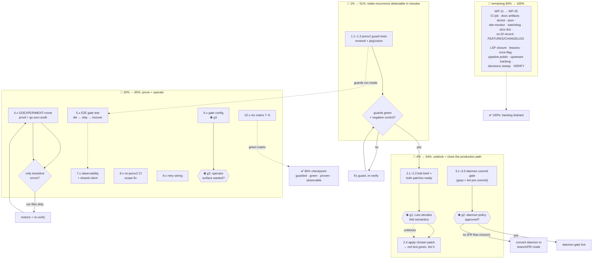

# Pareto Execution Plan — jsonv2 Hardening, Health-Gate Maturation, Master Green

**Created:** 2026-10-31 18:16 CET
**Session source:** `docs/status/2026-10-31_17-27_session-status-healthgate-jsonv2-restoration.md` (section f, 50 items) + this repo's living backlog
**Method:** Pareto tiers (1% → 51%, 4% → 64%, 20% → 80%, long tail → 100%), then two granularity levels: work packages (30–100 min) and micro-tasks (≤12 min)
**Scope note:** This plan owns THIS session's 50 harvest items. Pre-existing programs (website fleet, visionreviewd evo-x2 activation, DiscordSync watch, llama eval) live in `TODO_LIST.md` with their own plans and are referenced, not re-planned. Overlaps with the parallel session's harvest are recorded in the errata.

---

## 0. Situation in one paragraph

This session made master measurably better (health gate shipped, lint 11→1, jsonv2 tree clean) but exposed one systemic weakness: **the jsonv2 recurrence class has no automated guard at the point where it actually bites** (auto-commit direct pushes bypass CI), one permanent red (fold strictness, also the last lint finding), and a set of unverified verification claims. The Pareto cut below puts automated guards and decision-unblocking first, because both are cheap and every other improvement compounds on a green, guarded master.

**Open decisions that shape sequencing (asked 2026-10-31, unanswered):**
- **g1** fold semantics (tolerate vs strict) — gates WP-02's implementation half
- **g2** auto-commit daemon policy — gates WP-03 entirely
- **g3** health-gate operator surface — gates WP-06 and parts of WP-21

The plan is executable WITHOUT answers except where marked ⛔-decision.

---

## 1. Pareto breakdown

Percentages are cumulative **value** (risk-reduction + unblocking + green-master trust), mapped onto the micro-task population (~100 tasks). They are judgment, stated so they can be argued with — not fake precision.

### 🎯 The 1% that delivers 51%

**WP-01 — Package-local jsonv2 guard tests** (~3 micro-tasks, ~25 min)

Two `_test.go` additions (one in `internal/reviewd`, one in `pkg/vision` — reusing the proven `v5_guard_test.go` pattern with positive control) that walk their package's `.go` files and **fail if any file imports `encoding/json/v2` or `encoding/json/jsontext`**.

Why this is the 1%: seven recurrences over five weeks; the seventh sat in wire-format code for three weeks; CI cannot catch it (auto-commit bypasses PR checks). A guard test runs on every `go test` on every machine and in any future pre-commit gate — detection time collapses from **weeks to minutes**, everywhere, with zero infrastructure decisions needed. It is the only item whose completion makes an entire incident class *structurally impossible to miss*.

### 🎯 The 4% that delivers 64% (cumulative)

Adds (~+4 micro-tasks):

- **WP-02 — Fold-strictness decision brief** (⛔ g1): one page, two options, recommendation, both implementations pre-written as patches. The moment Lars answers, the only red test and the last lint finding clear — master goes fully green for the first time since 2026-10-05.
- **WP-03 — Auto-commit daemon commit gate** (⛔ g2): wrap the daemon's commit step with tree-grep + pinned lint; refuse-to-commit on findings. Closes the actual production path the seventh recurrence used. Highest leverage, blocked on your infra call.

### 🎯 The 20% that delivers 80% (cumulative)

Adds WP-04 … WP-10 (~+13 micro-tasks):

| WP | What | Why it's tier-2 |
|----|------|-----------------|
| WP-04 | `GOEXPERIMENT=none` SDK-subset proof + `go.sum` −92 investigation | Proves OUR tree is v1-clean (the blocker is transitive-only); closes "did we actually fix it" doubt |
| WP-05 | E2E gate test: `run` vs dying/recovering endpoint | The health gate is unit-tested; this proves the shipped behavior |
| WP-06 | Health-gate config fields (`probeTimeout`, `enabled`) ⛔ g3 | Turns a hard-coded policy into an operator-owned one |
| WP-07 | Gate observability: skip counters, state transitions, deferred views, shared http.Client | You cannot operate what you cannot see |
| WP-08 | `no-jsonv2` CI job scope decision + implementation | The job has been red for a transitive reason since 09-29; a red required job trains people to ignore red |
| WP-09 | Daemon retry wiring (`vision.Config.Retry`) | Already harvested to TODO_LIST by the parallel audit; biggest remaining resilience gap |
| WP-10 | Full verification matrix incl. nix steps 7–9 | The restoration has never been proven under the nix build |

### 🎯 The remaining 80% that delivers the last 20%

WP-11 … WP-25: scheduled CI grep job, documentation artifacts/errata, `doctor --json`, site-monitor hookup, watchdog, a2ui wire-semantics doc + baseline refresh, no-DI decision record, FEATURES/CHANGELOG, LSP closure, lessons, `once --skip-unhealthy` + probe backoff, disk-health probe + pipeline polish, upstream tracking + quant docs, decisions sweep, docs-health verify. All real, all scheduled, none allowed to starve the top tiers.

---

## 2. Comprehensive plan — work packages (30–100 min each, ALL 50 todos included)

Sorted by impact/effort/customer-value. ⛔ = waits on a decision from Lars.

| # | WP | Contains session items | Minutes | Impact | Effort | Customer value | Blocked? |
|---|-----|------------------------|---------|--------|--------|----------------|----------|
| 1 | **WP-01 jsonv2 guard tests** (reviewd + pkg/vision, positive controls) | #2, part of #3 | 25 | 🔴 Critical | S | Wire format permanently guarded | no |
| 2 | **WP-02 Fold-strictness decision brief + ready patches** | #12 | 45 | 🔴 Critical | S | Master fully green | ⛔ g1 (brief itself unblocked) |
| 3 | **WP-03 Auto-commit daemon gate** (grep+lint pre-commit, refuse-to-commit) | #1 | 60 | 🔴 Critical | M | Stops recurrence class at the source | ⛔ g2 |
| 4 | **WP-04 GOEXPERIMENT=none proof + go.sum audit** | #6, #7 | 45 | 🟠 High | S | Proof our tree is v1-clean | no |
| 5 | **WP-05 E2E gate test** (run vs dying/recovering fake server) | #13 | 75 | 🟠 High | M | Trusted self-healing behavior | no |
| 6 | **WP-06 Health-gate config** (`probeTimeout`, `enabled` in config.json) | #14 | 45 | 🟡 Medium | S | Operator control | ⛔ g3 |
| 7 | **WP-07 Gate observability** (skip counter, transitions, deferred views, shared client) | #15, #16, #19, #21 | 60 | 🟡 Medium | S | Operability | no |
| 8 | **WP-08 no-jsonv2 CI scope** (decision + subset redefinition or fantasy pin) | #9 | 75 | 🟠 High | M | Honest CI (no perma-red) | decision inside WP |
| 9 | **WP-09 Daemon retry wiring** (`Config.Retry` in reviewer, fake-server transient-500 test) | #20 | 75 | 🟠 High | M | Transient blips stop failing views | no |
| 10 | **WP-10 Full verification matrix + nix 7–9** | #41 | 60 | 🟠 High | M | Restoration proven end-to-end | no |
| 11 | **WP-11 Scheduled CI grep job** (weekly, whole tree) | #3 | 30 | 🟡 Medium | S | Drift caught ≤ 7 days anywhere | no |
| 12 | **WP-12 Verification-artifact norm + 2026-10-05 errata** | #4, #5 | 45 | 🟡 Medium | S | Docs regain trustworthiness | no |
| 13 | **WP-13 INDEX-under-skip semantics** (document or refresh; deferred-view log line) | #22 | 45 | 🟡 Medium | S | No silent stale INDEX | no |
| 14 | **WP-14 doctor --json + site-monitor gate-skip alert** | #24, #29 | 75 | 🟡 Medium | M | Machine-readable health, fleet alerting | no |
| 15 | **WP-15 systemd watchdog** (`Type=notify`, `WatchdogSec`, sd_notify per pass) | #27 | 75 | 🟡 Medium | M | Hung (not just crashed) daemon restarts | no |
| 16 | **WP-16 a2ui wire-semantics doc + baselines refresh + fuzz run** | #11, #39, #40 | 60 | 🟡 Medium | M | Regime-correct wire contract documented | no |
| 17 | **WP-17 "No DI container" decision record** (docs/decisions, revisit triggers) | #31, #25, #32 | 30 | ⚪ Low | S | Question never re-litigated | no |
| 18 | **WP-18 FEATURES/CHANGELOG + HARVEST this plan** | #33, #34, #45 | 45 | 🟡 Medium | S | Living docs reflect reality | no |
| 19 | **WP-19 LSP closure + doctor detail assertions** | #36, #37 | 45 | ⚪ Low | S | Trustworthy diagnostics, pinned output | no |
| 20 | **WP-20 Lessons + parallel-session norm + perf re-run + no-overlap race test** | #38, #30, #48, part #50 | 45 | ⚪ Low | S | Process debt paid | no |
| 21 | **WP-21 `once --skip-unhealthy` + probe backoff** | #17, #18 | 45 | ⚪ Low | S | Cron-safe operation | ⛔ g3 (partially) |
| 22 | **WP-22 Pipeline polish** (disk-health probe, per-glob isolation, pipeline-result struct, rename) | #26, #28, #43, #42 | 60 | ⚪ Low | S | Fewer blast-radius failures | no |
| 23 | **WP-23 Upstream tracking + quant/DEPS docs** | #10, #47, #35 | 45 | 🟡 Medium | S | Exit path from the transitive blocker | no |
| 24 | **WP-24 Decisions sweep** (record g1/g2/g3 outcomes when answered) | #44-part, #50-part | 30 | 🟡 Medium | S | Decisions durable | ⛔ g1–g3 |
| 25 | **WP-25 docs-health VERIFY of the three 2026-10-31 docs + skill case-study link** | #46, #49 | 30 | ⚪ Low | S | Cross-references stay true | no |

Coverage check: all 50 session items appear above (several merged into their natural package). ✔

---

## 3. Detailed breakdown — micro-tasks (≤12 min each, ALL todos)

Sorted within tiers by impact/effort. "WP" column links up. ⛔ = decision-gated.

| ID | Micro-task | WP | Min | Impact | Tier |
|----|-----------|----|-----|--------|------|
| 1.1 | Write `jsonv2_guard_test.go` for `internal/reviewd`: walk `*.go`, fail on v2/jsontext import, seeded positive control (temp file with v2 import → test detects it) | 01 | 12 | 🔴 | 1% |
| 1.2 | Same guard for `pkg/vision` (SDK consumer guarantee); run both suites green | 01 | 8 | 🔴 | 1% |
| 1.3 | Negative control: temporarily add a v2 import in a scratch file, watch guard fail, remove; document guard in AGENTS.md json bullet (one sentence) | 01 | 5 | 🔴 | 1% |
| 2.1 | Write fold-strictness decision brief: both options, consequences table (journal safety vs upgrade robustness), recommendation, affected code (`store.go:97`) + test | 02 | 12 | 🔴 | 4% |
| 2.2 | Pre-write patch A (tolerate: fold default returns state unchanged + logs once) as a local branch/stash-ready diff | 02 | 12 | 🔴 | 4% |
| 2.3 | Pre-write patch B (strict: keep error, change test to assert failure carries type+stream) | 02 | 12 | 🔴 | 4% |
| 2.4 | Hand brief to Lars (chat), record decision in `docs/decisions/` when it lands ⛔g1 | 02 | 9 | 🔴 | 4% |
| 3.1 | Read the auto-commit daemon's source/config to find its commit hook point (local checkout of the daemon repo) ⛔g2 | 03 | 12 | 🔴 | 4% |
| 3.2 | Design the gate: pre-commit exec of `grep -rn 'encoding/json/(v2\|jsontext)' --include='*.go'` + `nix run .#lint` (or cached equivalent) ⛔g2 | 03 | 12 | 🔴 | 4% |
| 3.3 | Implement refusal path: on finding, skip commit, log the offending files loudly ⛔g2 | 03 | 12 | 🔴 | 4% |
| 3.4 | Test the gate end-to-end: dirty tree with a v2 import → daemon refuses; clean tree → commits ⛔g2 | 03 | 12 | 🔴 | 4% |
| 3.5 | Document the new daemon contract in AGENTS.md git section ⛔g2 | 03 | 12 | 🟠 | 4% |
| 4.1 | Run `GOEXPERIMENT=none go build ./pkg/... ./cmd/vision/... ./internal/{catalog,cli,visionutil}/... ./examples/...`; capture full error list | 04 | 12 | 🟠 | 20% |
| 4.2 | Assert every error references ONLY kaptinlin/fantasy transitive files; write result into AGENTS.md json bullet (artifact, not prose) | 04 | 12 | 🟠 | 20% |
| 4.3 | `git show fad59ce -- go.sum` diff review: list removed modules; `go mod graph` spot-check each for remaining reachability | 04 | 12 | 🟡 | 20% |
| 4.4 | Inspect `fad59ce`'s SECURITY.md hunk; verdict recorded here (intentional / revert) | 04 | 9 | ⚪ | 20% |
| 5.1 | Extend `fakeserver_test.go` (or new `healthgate_e2e_test.go`): boot daemon deps over a fake server, flip handler to 500 after first pass | 05 | 12 | 🟠 | 20% |
| 5.2 | Assert pass 2: one warning, zero inner-runner view errors, zero writes | 05 | 12 | 🟠 | 20% |
| 5.3 | Flip handler healthy again; assert pass 3 reviews the deferred captures (skip-seen keying intact) | 05 | 12 | 🟠 | 20% |
| 5.4 | Assert no data loss: capture hashes from skipped pass all reviewed after recovery | 05 | 12 | 🟠 | 20% |
| 5.5 | Race-run the E2E spec | 05 | 6 | 🟡 | 20% |
| 6.1 ⛔g3 | Add `ProbeTimeout time.Duration` + `HealthGate *bool` to Config with defaults (5s, on) + Validate bounds | 06 | 12 | 🟡 | 20% |
| 6.2 ⛔g3 | Thread config → `gatedRunner`; defaults keep behavior identical for existing configs | 06 | 12 | 🟡 | 20% |
| 6.3 ⛔g3 | Config tests: defaults, invalid values (≤0 timeout), kill-switch off → no gate | 06 | 12 | 🟡 | 20% |
| 6.4 ⛔g3 | Document fields in `discover`'s suggested config JSON + README daemon section | 06 | 9 | ⚪ | 20% |
| 7.1 | Package-level shared probe `http.Client` (timeout still per-call via context) | 07 | 8 | ⚪ | 20% |
| 7.2 | `HealthGate` counters: consecutive skips, last-healthy time; include in Warn + pass-complete log attrs | 07 | 12 | 🟡 | 20% |
| 7.3 | State-transition Info logs: healthy→unhealthy (first skip), unhealthy→healthy (recovery) | 07 | 12 | 🟡 | 20% |
| 7.4 | On skip, log deferred view keys per project (from ScanProject? no — defer to next pass; log project names + capture count from previous scan) | 07 | 12 | ⚪ | 20% |
| 8.1 | Write `no-jsonv2` scope options: (a) fantasy-free subset, (b) pin fantasy v0.41.1, (c) drop job until kaptinlin dual-regime; tradeoffs table | 08 | 12 | 🟠 | 20% |
| 8.2 | Implement chosen default: (a) = compute the fantasy-free package set in ci.yml; verify it builds under `GOEXPERIMENT=none` locally | 08 | 12 | 🟠 | 20% |
| 8.3 | Update ci.yml job + local verify script; commit; watch the required check flip green | 08 | 12 | 🟠 | 20% |
| 9.1 | Read `vision.RetryConfig` semantics (backoff+jitter, `IsRetryable`); design daemon defaults (e.g. 3 retries, 2s base) | 09 | 12 | 🟠 | 20% |
| 9.2 | Add `retry` stanza to daemon Config + Validate + defaults; document | 09 | 12 | 🟠 | 20% |
| 9.3 | Wire into `newAgent` (`reviewer.go`): `Config.Retry` from daemon config when set | 09 | 12 | 🟠 | 20% |
| 9.4 | Fake-server test: transient 500 then 200 → one review, 2 model calls, no per-view error | 09 | 12 | 🟠 | 20% |
| 9.5 | AGENTS.md daemon bullet update (retry policy now wired; note streaming exemption) | 09 | 6 | 🟡 | 20% |
| 10.1 | `nix run .#test` | 10 | 12 | 🟠 | 20% |
| 10.2 | `nix run .#lint` (already green this session — re-run as part of the set) | 10 | 12 | 🟠 | 20% |
| 10.3 | `nix build .` + `nix build .#visionreviewd` + version smoke | 10 | 12 | 🟠 | 20% |
| 10.4 | `nix flake check` incl. nixos-module eval checks; record artifacts in the status doc (dates + outputs) | 10 | 12 | 🟠 | 20% |
| 11.1 | Add `.github/workflows/scheduled-jsonv2-guard.yml`: weekly cron, tree-wide grep, fails on findings | 11 | 12 | 🟡 | 20% |
| 11.2 | Optional: same workflow runs `go test -run TestNoJSONv2Imports ./...` once guards exist | 11 | 6 | 🟡 | 20% |
| 12.1 | AGENTS.md norm edit: add one line to the memory-maintenance or verification section — "verification claims must embed command + date" | 12 | 8 | 🟡 | 20% |
| 12.2 | ANNOTATE `docs/status/2026-10-05_15-42_strong-id-pass-status.md`: append errata noting the grep-clean claim missed fakeserver_test.go (never rewrite) | 12 | 8 | 🟡 | 20% |
| 12.3 | ANNOTATE the json bullet's claim (done in session already — verify wording present, done → skip) | 12 | 2 | ⚪ | 20% |
| 13.1 | Decide + document: skipped pass leaves INDEX untouched (stale-but-true) vs refresh-with-unchanged — write behavior into the gate's doc comment + DOMAIN_LANGUAGE Health-gate row | 13 | 12 | 🟡 | 20% |
| 13.2 | If refresh chosen: `HealthGate` calls writer refresh on skip path | 13 | 12 | ⚪ | 20% |
| 14.1 | `doctor --json`: marshal `[]doctorCheck` + summary; flag wiring; keep text default | 14 | 12 | 🟡 | 20% |
| 14.2 | main_test.go: JSON-mode assertions (valid JSON, counts, statuses) | 14 | 12 | 🟡 | 20% |
| 14.3 | site-monitor.sh: grep daemon journal for `pass skipped, model endpoint unhealthy` ≥ N consecutive → notify (reuse existing notify path) | 14 | 12 | 🟡 | 20% |
| 15.1 | Read systemd notify requirements; add `Type=notify` + `WatchdogSec=2×interval` option to NixOS module (default off) | 15 | 12 | 🟡 | 20% |
| 15.2 | Daemon: `systemd notification` via `go-systemd` or raw socket send per completed pass (READY=1 + WATCHDOG=1); gate behind env detection | 15 | 12 | 🟡 | 20% |
| 15.3 | Test: unit starts under a transient systemd scope locally; hung-pass simulation not required (document) | 15 | 12 | ⚪ | 20% |
| 16.1 | Write the omitempty/omitzero dual-regime paragraph into `messages.go` at `SendDataModel` (v1: omit-false; v2: omitzero required; Go 1.24+ v1 knows omitzero → current tag is regime-stable) | 16 | 12 | 🟡 | 20% |
| 16.2 | Re-run a2ui coverage + the 4 benchmarks; update AGENTS.md baselines if moved | 16 | 12 | ⚪ | 20% |
| 16.3 | 10-minute fuzz run over `UnmarshalMessage`/`MarshalJSONL` targets; record execs/failures | 16 | 12 | ⚪ | 20% |
| 17.1 | `docs/decisions/2026-10-31_no-di-container.md`: context, DO-audit summary, revisit triggers (verbatim from R5) | 17 | 12 | ⚪ | 20% |
| 17.2 | Add `var _ PassRunner = (*HealthGate)(nil)` compile-time assertion | 17 | 2 | ⚪ | 20% |
| 18.1 | FEATURES.md: daemon gains health gate + endpoint probe (DONE), retry/watchdog (PLANNED) | 18 | 12 | 🟡 | 20% |
| 18.2 | CHANGELOG `[Unreleased]`: health gate, seventh restoration, ErrorKind completion, guard tests (as they land) | 18 | 12 | 🟡 | 20% |
| 18.3 | HARVEST: TODO_LIST.md gains tier-1/2 items not already present (fold brief pointer, guard tests, WP-04 proof) | 18 | 12 | 🟠 | 20% |
| 19.1 | `lsp_restart`; re-open the 4 files; record which warnings cleared (expect all four: depguard/gci/gocognit stale, err113 real) | 19 | 8 | ⚪ | 20% |
| 19.2 | main_test.go: pin doctor endpoint failure DETAIL strings (exact dial-error shape, not-listed text) through the probe delegation | 19 | 12 | ⚪ | 20% |
| 20.1 | Add lesson (crush-config repo, by commit): parallel sessions + auto-commit on one tree → interleaved authorship; check `git log` before claiming state | 20 | 12 | 🟡 | 20% |
| 20.2 | Re-run daemon perf baseline incl. one gated pass; note probe cost | 20 | 12 | ⚪ | 20% |
| 20.3 | Race test: two concurrent `Pass` calls on one Pipeline → serialize or document non-overlap guarantee source (Daemon ticker) | 20 | 12 | ⚪ | 20% |
| 21.1 ⛔g3 | `once --skip-unhealthy` flag: wire gatedRunner variant into runOnceCommand behind flag | 21 | 12 | ⚪ | 20% |
| 21.2 ⛔g3 | Probe backoff: after 3 consecutive skips, log at Info and skip probe until next interval (state on gate) | 21 | 12 | ⚪ | 20% |
| 21.3 | Tests for both | 21 | 12 | ⚪ | 20% |
| 22.1 | Disk-health probe at Pass start: write+remove probe file in dataDir; fail pass early with one error | 22 | 12 | 🟡 | 20% |
| 22.2 | Per-glob isolation in ScanProject: collect bad patterns as per-pattern errors, keep good ones | 22 | 12 | ⚪ | 20% |
| 22.3 | `openConfiguredPipeline` → small result struct (config, pipeline, store) + call-site updates | 22 | 12 | ⚪ | 20% |
| 22.4 | Rename `gatedRunner` → `healthGatedRunner`; update comments | 22 | 3 | ⚪ | 20% |
| 23.1 | Draft upstream-tracking note in DEPS.md: kaptinlin dual-regime watch + fantasy pin option table | 23 | 12 | 🟡 | 20% |
| 23.2 | Q8_0 vs smaller-quant tradeoff doc (recovery speed vs fidelity) — decision left open | 23 | 12 | ⚪ | 20% |
| 23.3 | Seventh-recurrence post-mortem note in DEPS.md json section (link AGENTS.md paragraph) | 23 | 8 | 🟡 | 20% |
| 24.1 ⛔g1–g3 | When decisions land: append each to `docs/decisions/` with date + rationale; update AGENTS.md pointers | 24 | 12 | 🟡 | 20% |
| 25.1 | docs-health VERIFY pass over the three 2026-10-31 docs (status ×2 + this plan): claims vs code | 25 | 12 | ⚪ | 20% |
| 25.2 | Link this plan + status report from the samber-do skill's workspace case studies (by commit in the skill's repo, if it accepts links) | 25 | 8 | ⚪ | 20% |
| 25.3 | Schedule next status report after WP-01/02/03 land; verify recurrence class 8 did not occur | 25 | 4 | 🟡 | 20% |

Coverage check: every one of the 50 session items is executable through the micro-tasks above (merged where natural; overlaps with TODO_LIST harvest noted in errata). ✔

---

## 4. Errata (Step-0 verification of the backlog)

| Claim/source | Correction |
|---|---|
| Session items #12 (fold), #20 (retry), #27 (watchdog), #15/16 (observability) | **Already harvested** to `TODO_LIST.md` by the parallel 14:41 session under "Architecture review 2026-10-31". This plan references them (WP-02/09/15/07) and adds the *execution detail*; HARVEST must not create duplicates. |
| My status report's "R1 not implemented" | Correct — remains open, gated on g2. |
| My status report's lint claim "1 issue" | Re-verified true at plan time (pinned CLI, `err113` only — the KNOWN RED line). |
| All other 44 session items | Not present in TODO_LIST/ROADMAP → genuinely new harvest candidates. |

---

## 5. Execution graph

**Sequencing rule:** WP-01 first (it is unblocked, ~25 min, and every later change re-runs its guards). WP-02's brief and WP-03's design can proceed in parallel with WP-04/05/10; only their *application* waits on g1/g2. Tier-3 never starts before the 20% checkpoint is green.

---

## 6. Verschlimm-besserung guards (how this plan avoids making things worse)

1. **No production code changes in tier 1** — guard tests only observe; they cannot alter behavior.
2. **Fold patch is not applied without g1** — both implementations pre-written, neither merged on speculation.
3. **Daemon gate is refuse-to-commit, not rewrite-the-daemon** — smallest possible diff to Lars's infra, and only after g2.
4. **Config additions default to today's behavior** (`probeTimeout=5s`, gate on) — existing deployments see zero change.
5. **Every WP ends in its package's tests**; tier-2 ends with the full matrix including nix.
6. **Docs are annotated, never rewritten** (2026-10-05 errata follows docs-health ANNOTATE).

---

*Point-in-time plan. When items ship, tick them here ONLY if a later task explicitly refreshes this file; the living source is `TODO_LIST.md` (HARVEST owns the transfer).*
